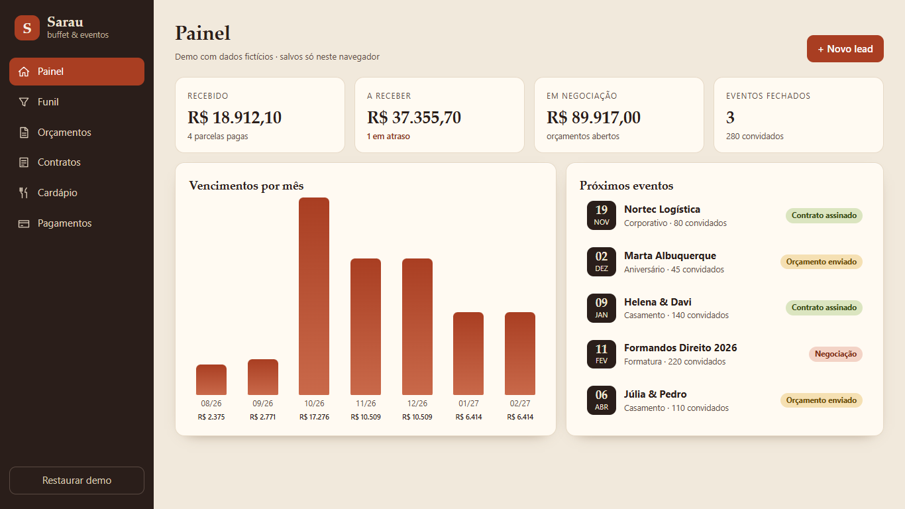
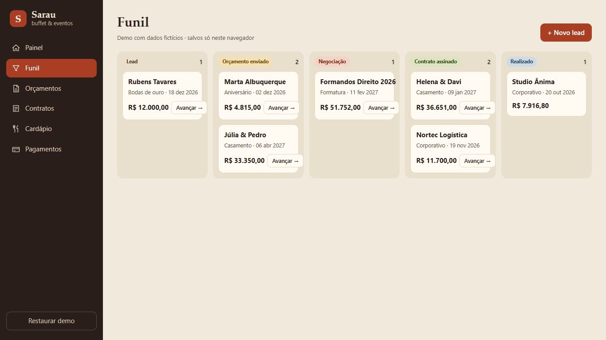
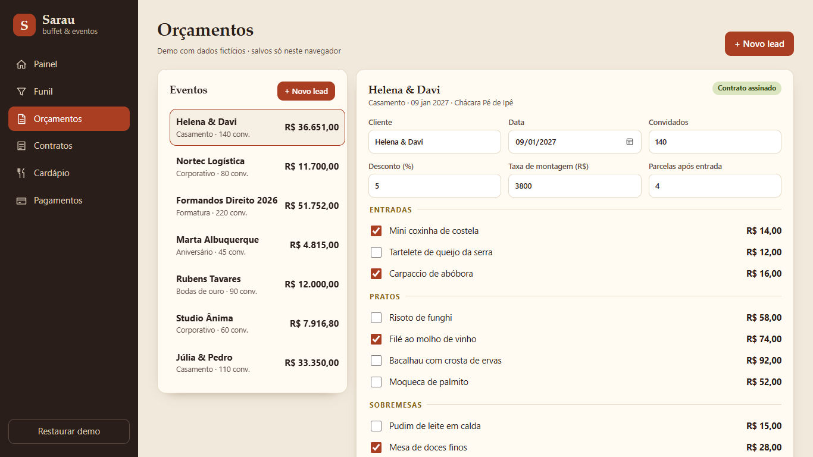
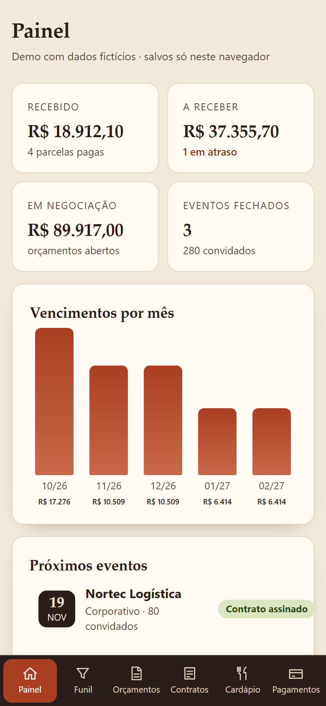

# Sarau — catering & events CRM (demo)

A small CRM for a catering/event company: sales pipeline, quote builder, contracts, menu pricing and payment tracking. Built with **SolidJS + Vite**, no backend: everything is saved in `localStorage`.

> All names, companies and amounts are **fictitious demo data**. "Sarau" is an invented brand.

**Live demo:** https://alissonlittig.github.io/sarau-eventos-crm/



## Features
- **Dashboard** — received vs. receivable, overdue installments, open pipeline value, monthly due-date chart, upcoming events.
- **Pipeline** — Lead → Quote sent → Negotiation → Signed contract → Done; advance a deal in one click.
- **Quotes** — pick menu items, guests, discount and setup fee; total and estimated margin update live.
- **Contracts** — generated from the quote when a deal is signed (30% down payment + monthly installments); printable / save as PDF.
- **Menu** — editable price per guest with cost and margin per dish.
- **Payments** — filter open / overdue / paid, mark installments as paid.
- Responsive down to 390 px (bottom tab bar on phones), keyboard accessible, print stylesheet for contracts.

| Pipeline | Quote builder | Mobile |
|---|---|---|
|  |  |  |

## Run it
```bash
npm install
npm run dev      # development
npm test         # business rules (quote total, installments, seed data)
npm run build    # static build in dist/
```

## Notes
- Business rules live in `src/lib.js` (pure functions, covered by `test/lib.test.js`).
- CI (`.github/workflows/pages.yml`) runs tests, builds and deploys to GitHub Pages.
- Lighthouse (mobile): Performance 100 · Accessibility 100 · Best practices 100 · SEO 91 on localhost (robots.txt added).
